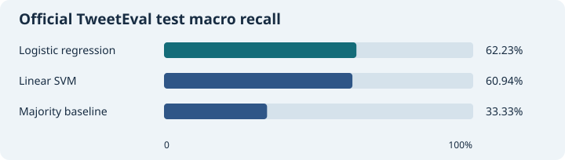
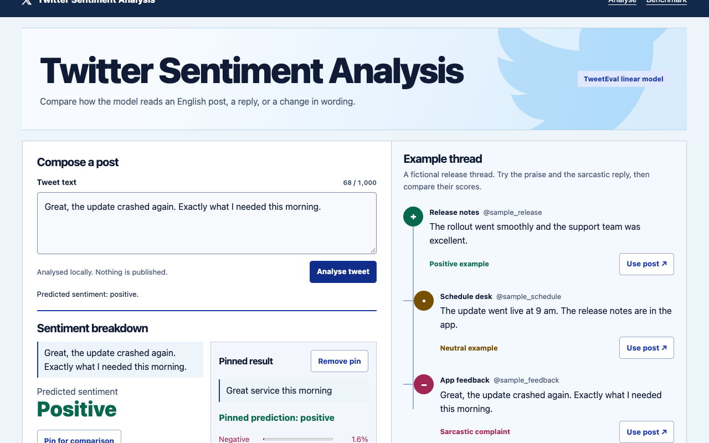

# Twitter Sentiment Analysis

A reproducible Python experiment for classifying English tweets as negative, neutral or positive. It compares a TF-IDF logistic regression model against a linear SVM and a majority-class baseline on the same official test split.


## Compare the three sentiment classifiers



Logistic regression leads the linear SVM by 1.29 percentage points on 12,284 official test posts. The two linear models use the same word and character features. The browser demo serves logistic regression.

## Interview demo and measured benchmark

Pin the first TweetEval prediction and compare it with a sarcastic reply. The example thread is fictional.

[Watch the 15-second captioned walkthrough](https://raw.githubusercontent.com/Khushx11/twitter-sentiment-analysis/main/docs/demo/walkthrough.mp4)

[](https://raw.githubusercontent.com/Khushx11/twitter-sentiment-analysis/main/docs/demo/walkthrough.mp4)

Install the package, get the publisher’s fixed splits, then train and launch the browser interface.

```sh
python -m pip install .
git -c core.autocrlf=false clone https://github.com/cardiffnlp/tweeteval.git data/tweeteval
git -C data/tweeteval checkout 4fbd22cd78421f05b1ecdb4fc5725bc7a7bd8f66
python -m post_sentiment.benchmark data/tweeteval/datasets/sentiment --output runs/tweeteval
python -m post_sentiment.web --model runs/tweeteval/model.joblib
```

Open http://127.0.0.1:8001. Paste an English tweet or load a post from the fictional release thread. Select **Analyse tweet** to see the predicted label and all three model scores. Pin a result and analyse a second post to compare the scores. Open **Benchmark** to inspect the attached evaluation and per-class errors. The app processes text locally. Starting without `--model` uses the synthetic smoke test.

The linear model achieved **62.23% macro recall**, **60.85% macro-F1** and **60.96% accuracy** on 12,284 official test posts. The same-split linear SVM achieved **60.94% macro recall** and the majority baseline achieved **33.33%**. Both linear models use identical features and tune regularisation separately on validation data. The live dashboard runs logistic regression. The benchmark verifies all six source files against the pinned SHA-256 hashes before fitting. We fit word and character features on the official training set, select regularisation on the validation split and score the locked model on the test split. Macro recall is the benchmark’s primary sentiment metric. The audit found zero exact normalised training-text matches in validation or test. This does not rule out paraphrases, similar topics, or temporal overlap. [Measured results and input hashes](docs/tweeteval-results.json)

The benchmark evaluates an English short-post classifier and its scores are uncalibrated. Live inference abstains when the input produces no features from the training vocabulary. Treat it as a lightweight baseline on this historical dataset. The benchmark uses TweetEval by Barbieri, Camacho-Collados, Neves and Espinosa-Anke (2020) and the underlying SemEval sentiment task. See upstream terms before downloading or reusing any posts. The project repository includes aggregate measurements. [TweetEval sources and terms](https://github.com/cardiffnlp/tweeteval/tree/4fbd22cd78421f05b1ecdb4fc5725bc7a7bd8f66)

The TweetEval benchmark scores every official test row. All 12,284 test rows activated at least one word or character feature in this run. The dashboard reports that count when it is present in the trained model’s evaluation record.

## Run it locally

Requires Python 3.10 or later.

```sh
python -m pip install .
post-sentiment train examples/labelled_posts.csv --output runs/demo
post-sentiment predict runs/demo/model.joblib "The support team was helpful"
python -m unittest discover -s tests -v
```

The demo uses 30 hand-written synthetic posts. It exercises training, evaluation and model reload. Eight held-out examples are too few to estimate real-world performance.

## Use another dataset

Supply a UTF-8 CSV with `text,label` columns and at least five distinct examples per class. The pipeline masks links and mentions, collapses exact normalised duplicates and rejects conflicts. It makes a seeded stratified split before fitting word and character TF-IDF. The output records macro-F1, accuracy, confusion matrices, class supports and the input file's SHA-256. Use a fresh output directory for each run.

Collect posts under terms that allow your intended use. For a realistic benchmark, split by author, conversation or time where that metadata exists. Exact deduplication does not catch paraphrases, repeated topics or shared authors. Sarcasm, domain shifts and annotator disagreement can reduce accuracy. Prediction scores are model outputs and have not been calibrated. Load only model artefacts you created locally because joblib loads executable Python objects.

Khush Bhavin Maru · Adelaide University MAAIM portfolio. Codex assisted with implementation and documentation.

The background uses the historical [Twitter bird mark](https://blog.x.com/official/en_us/a/2012/taking-flight-twitterbird.html), adapted from [Twitter’s open-source website](https://github.com/twitter/opensource-website/blob/2887311216d99cd0e38b16e564bcdbea3797eb63/static/assets/twitter-logo.svg). Twitter branding belongs to its owner.
